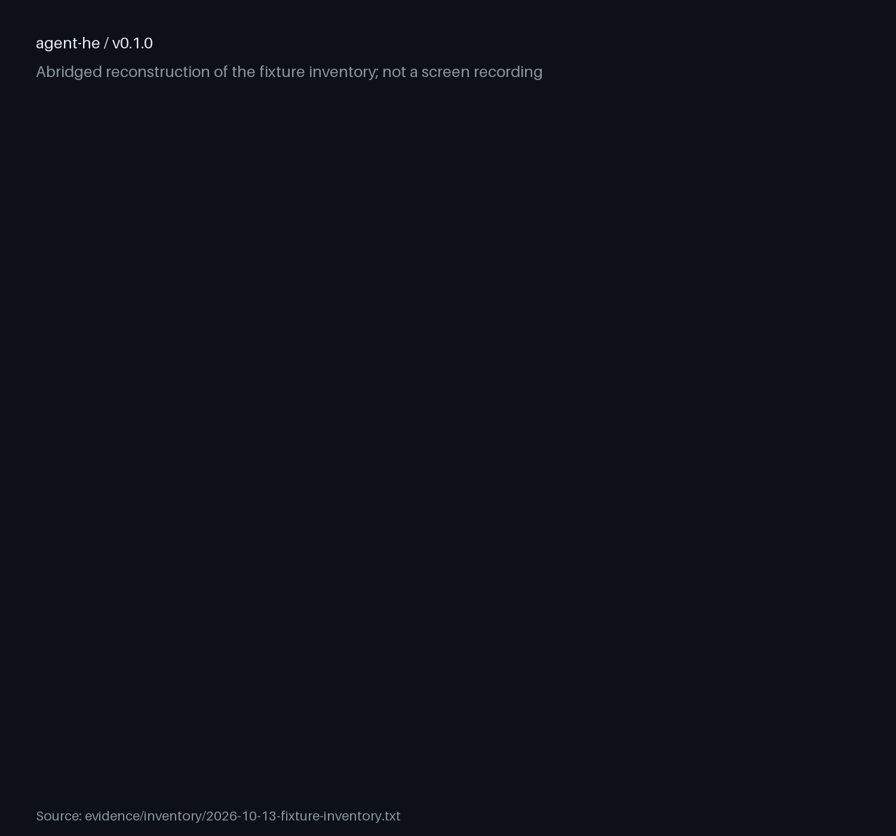

# agent-he

Measured agent heuristic evaluation, not a skim.

[](https://github.com/trycopilotai/agent-heuristic-analysis/actions/workflows/auto-lint-pr.yml)
[](https://github.com/trycopilotai/agent-heuristic-analysis/actions/workflows/check.yml)
[](https://github.com/trycopilotai/agent-heuristic-analysis/actions/workflows/lint.yml)

An agent skill that runs Nielsen’s heuristic evaluation on a
live UI with agent-specific measurement rules — source
sweep, contrast arithmetic, multi-scale sampling, and attack
on the product’s own promise — and emits a severity-ranked
findings report. The point is that an agent’s HE is worth
more than a skim, not less.

Recorded run: inventory on the shipped fixtures produced
four severity-ranked HTML/metadata findings on the bad
fixture (F1–F4); F5 is a sample-palette border contrast
failure recorded beside them. The good fixture cleared the
HTML/metadata checks. That run is in
[`evidence/`](evidence/). It is not a benchmark.

## Demo



This looping reconstruction derives its rows from the
[fixture inventory transcript](evidence/inventory/2026-10-13-fixture-inventory.txt),
not a screen capture. For reduced motion, open the
[static poster](assets/demo-poster.png).

## What it returns

A severity-ranked findings table with heuristic IDs, then a
compliance section that also records which heuristics drew
zero violations.

| ID  | Severity | Heuristic | Summary                                             |
| --- | -------- | --------- | --------------------------------------------------- |
| F1  | 3        | H11       | `<html>` has no `lang` on the bad fixture           |
| F4  | 3        | H11       | 1 of 2 images has no `alt`                          |
| F2  | 2        | H2, H11   | Raw `&#8211;` entities leak into the title and body |
| F3  | 2        | H2        | No Open Graph or Twitter-card metadata              |
| F5  | 2        | H11       | Sample palette border fails WCAG 1.4.11 at 1.24:1   |

This table is from the
[worked example](evidence/findings/WORKED_EXAMPLE.md)
against the shipped fixtures. New runs use whatever UI you
point the skill at.

## Use it

### Claude Code

Save this as `install.sh` and run it. It sets `set -eu` and
an `EXIT` trap, so pasting it straight into an interactive
shell will end that shell if the clone fails.

```sh
set -eu
release=v0.1.0
install_parent="$HOME/.claude/skills/"
install_target="$install_parent/agent-he"
mkdir -p "$install_parent"
install_tmp="$(mktemp -d "$install_parent/.agent-he.XXXXXX")"
install_stage="$install_tmp/package"
rollback_install() {
  if [ ! -e "$install_target" ]; then
    if [ -e "$install_tmp/previous" ]; then
      mv "$install_tmp/previous" "$install_target"
    fi
  fi
  rm -rf "$install_tmp"
}
trap rollback_install EXIT
git clone --quiet --depth 1 --branch "$release" \
  https://github.com/trycopilotai/agent-he \
  "$install_tmp/agent-he"
mkdir -p "$install_stage"
cp -R "$install_tmp/agent-he/skill/." "$install_stage/"
if [ -e "$install_target" ]; then
  mv "$install_target" "$install_tmp/previous"
fi
mv "$install_stage" "$install_target"
trap - EXIT
rm -rf "$install_tmp"
```

Or, when this version is registered, alongside the other
[trycopilot.ai skills](https://github.com/trycopilotai/skills):

```text
/plugin marketplace add trycopilotai/skills
/plugin install agent-he@trycopilotai
```

Invoke the directly installed skill as `/agent-he`, or the
marketplace plugin as `/agent-he:agent-he`.

### Codex

Save this one the same way. The only line that differs from
the block above is `install_parent`.

```sh
set -eu
release=v0.1.0
install_parent="$HOME/.agents/skills/"
install_target="$install_parent/agent-he"
mkdir -p "$install_parent"
install_tmp="$(mktemp -d "$install_parent/.agent-he.XXXXXX")"
install_stage="$install_tmp/package"
rollback_install() {
  if [ ! -e "$install_target" ]; then
    if [ -e "$install_tmp/previous" ]; then
      mv "$install_tmp/previous" "$install_target"
    fi
  fi
  rm -rf "$install_tmp"
}
trap rollback_install EXIT
git clone --quiet --depth 1 --branch "$release" \
  https://github.com/trycopilotai/agent-he \
  "$install_tmp/agent-he"
mkdir -p "$install_stage"
cp -R "$install_tmp/agent-he/skill/." "$install_stage/"
if [ -e "$install_target" ]; then
  mv "$install_target" "$install_tmp/previous"
fi
mv "$install_stage" "$install_target"
trap - EXIT
rm -rf "$install_tmp"
```

Or, when this version is registered, from the marketplace:

```sh
npx -y @openai/codex plugin marketplace add \
  trycopilotai/skills
npx -y @openai/codex plugin add agent-he@trycopilotai
```

Invoke the directly installed skill as `$agent-he`, or the
marketplace plugin as `$agent-he:agent-he`. Codex selects
skills with `$`; `@` is the ChatGPT form and is not a Codex
selector.

The four forms are two pairs. A skill you cloned yourself is
addressed by its own name — `/agent-he` in Claude Code,
`$agent-he` in Codex. A skill installed from a marketplace
is namespaced by the plugin it arrived in, so it takes the
longer form: `/agent-he:agent-he` and `$agent-he:agent-he`.

For a checked-out repository, Claude also supports
`claude --plugin-dir /absolute/path/to/agent-he` and
`/agent-he:agent-he`. Codex can load the local catalogue:

```sh
codex plugin marketplace add /absolute/path/to/agent-he
codex plugin add agent-he@trycopilotai-agent-he
```

The `v0.1.0` tagged repository carries a portable root
`plugin.json` plus Claude Code and Codex plugin manifests.
Both runtimes load the canonical package under
`skills/agent-he`; `skill/SKILL.md` resolves to that
package, so the skill content is stored once.

The clone is pinned to a tag rather than to `main`. This
file is an instruction set that steers an agent, so a
mutable branch would silently change what it is told to do.
Read [`skills/agent-he/SKILL.md`](skills/agent-he/SKILL.md)
before you invoke it. (`skill/` is a symlink to that
directory, which GitHub's web view will not follow.)

## Method and playbook

| File                                                                                             | What it is                                        |
| ------------------------------------------------------------------------------------------------ | ------------------------------------------------- |
| [`skills/agent-he/references/METHOD.md`](skills/agent-he/references/METHOD.md)                   | The thirteen heuristics, verbatim from the source |
| [`skills/agent-he/references/AGENT_PLAYBOOK.md`](skills/agent-he/references/AGENT_PLAYBOOK.md)   | The ten agent-specific rules                      |
| [`skills/agent-he/references/MULTI_EVALUATOR.md`](skills/agent-he/references/MULTI_EVALUATOR.md) | How to run the 3–5 evaluators the method asks for |
| [`skills/agent-he/references/REPORT_TEMPLATE.md`](skills/agent-he/references/REPORT_TEMPLATE.md) | The output shape                                  |

The method is
[Heuristic Evaluation, p13i.io HCI notes](https://p13i.io/posts/2022/07/intro-hci-design/#heuristic-evaluation)
— Nielsen's ten heuristics plus three CS147 course-staff
additions (accessible, fairness and inclusion, value
alignment). It is reproduced in `METHOD.md` without
rewording.

## Verify

```sh
make check
```

Compiles the scripts and runs every test. No third-party
dependencies for the check target; standard library only.
Demo rebuild needs Pillow (see `CONTRIBUTING.md`).

## License

MIT. See [`LICENSE`](LICENSE).
